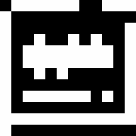
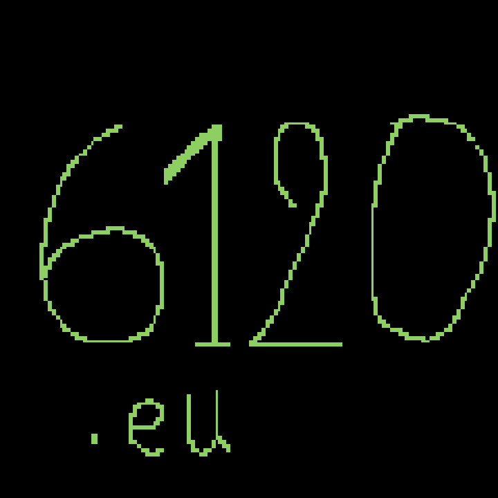
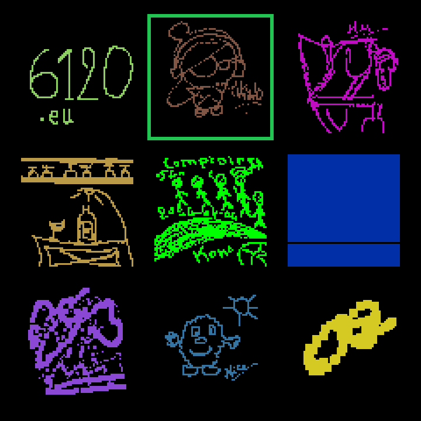
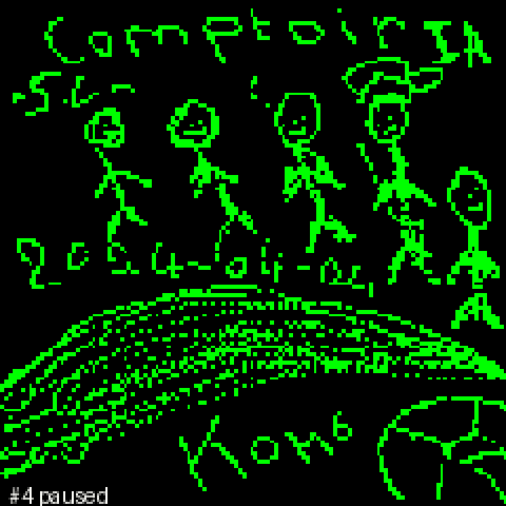
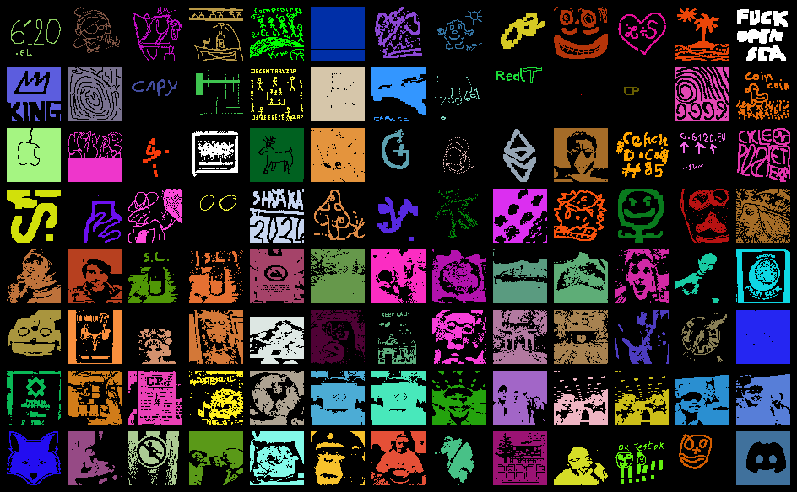

# Graffiti for wedgie 

A [wedgie](https://wedgie.dev) app that shows the Graffiti NFT collection (`GraffitiBaseNFT`).
Each graffiti is a 128x128 drawing in one color on black, stored fully on-chain.

**[Try it in your browser](https://magicking.github.io/graffiti-wedgie/)**: a phone-first demo with
the same views, the same controls and all 104 graffiti. No wallet, no install.

<p>



</p>

The app icon is graffiti #0 on Base (the "GRAFFITI" tag, #29 in the snapshot), shrunk to 12x12 by
`tools/make_icon.py`.

## Views

| | Single | Wall | Slideshow |
|---|---|---|---|
| What | one graffiti over the whole screen | nine at half size | the next one every 3, 5 or 10 s |
| joystick left/right | previous / next | move | previous / next |
| joystick up/down | | move | |
| green / joystick press | start the slideshow | open the one picked | pause |
| red | go to the wall | | back to single |
| grey X | settings | settings | settings |
| grey B | ask the chain again (live only) | | |

The settings screen chooses where the graffiti come from and how fast the slideshow goes. Both
choices are saved.

## Where the graffiti come from

- **Snapshot** (the default): every graffiti is packed into the app in `graffiti_snap.bin`, about
  216 KB. It works with no computer attached and loads instantly. It holds the 104 Blast graffiti from
  the migration snapshot. Their numbers are the Blast ids, which are also the Sepolia ids.
- **Live**: a chain from `graffiti/graffiti_chains.json` (Sepolia, Base, Linea), read with
  `getGraffitiBase(id)` through `net.chain`. A wedgie has no internet of its own, so **keep its page
  on wedgie.dev open** (wedgie.dev/connect, then pick it) or run `python3 wedgie.py net`. Answers on
  chains other than Ethereum come from wedgie.dev's relay, which could change them. That's fine for
  looking at pictures. If the relay doesn't serve a chain, the app says so and offers the snapshot.

Rebuild the snapshot:

```sh
python3 -I tools/build_snapshot.py                                   # from the graffiti-nft migration plan (plan-8453.json)
python3 -I tools/build_snapshot.py --from-chain 11155111 --rpc https://1rpc.io/sepolia   # live (needs Foundry's cast)
```

## Deployments

| Chain | Id | GraffitiBaseNFT |
|---|---|---|
| Sepolia | 11155111 | `0x47C630e06dB81eFa055Fa94EdE0A050e1150e56c` |
| Base | 8453 | `0xcc39fe145eece8a733833d7a78dca7f287996693` |
| Linea | 59144 | `0xE6d6AacC26201AFf57a666090f789b15591a8e44` |

## Install

From a computer with the wedgie plugged in:

```sh
python3 wedgie.py install .        # then press green on the wedgie
```

You can also open the wedgie's page on wedgie.dev and use Software, then "Apps from a GitHub repo".
An app installed from GitHub is **not signed by wedgie.dev and runs with full access**, so only
install it from a repo you trust.

## Files

| File | What |
|---|---|
| `wedgie.json` | the app manifest |
| `graffiti/graffiti.py` | views, keys, settings, the loop |
| `graffiti/graffiti_draw.py` | viper drawing: 128 to 240 scaling and 64px thumbnails into the 4-bit screen |
| `graffiti/graffiti_chain.py` | the snapshot reader and live `net.chain` reads |
| `graffiti/graffiti_chains.json` | chain id, name, contract address |
| `graffiti/graffiti_snap.bin` | the packed snapshot (format in `tools/build_snapshot.py`) |
| `tools/build_snapshot.py` | builds the snapshot |
| `tools/make_icon.py` | draws the 12x12 icon from a graffiti |
| `tests/test_graffiti.py` | host test with fake firmware: pixels against the contract's own BMP, every view |
| `tests/shots.py` | renders the screenshots in `docs/img` |
| `docs/` | the browser demo (GitHub Pages) and screenshots |

Host test: `python3 -I tests/test_graffiti.py graffiti tests/fixtures /tmp/out`.



MIT.
